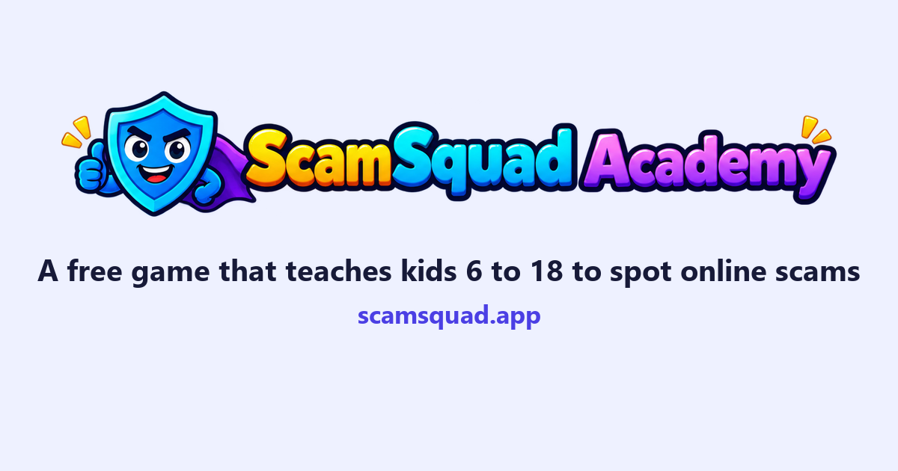

# ScamSquad Academy

**Play it free at [scamsquad.app](https://scamsquad.app)**



A free game that teaches kids aged 6 to 18 how to spot online scams and tricks, and what to do
if something goes wrong. Made by Arvin Challa, a high school student in Texas, built openly with
AI help.

There is no sign-up. It never asks for a login, an email or a phone number, and progress stays
on the player's own device. The only thing the game ever sends is one anonymous +1 to a "played
on N devices" count, the first time it opens on a device.

## What's in it

- **Three age groups**, each with its own buddy, look and words: Explorers (6 to 9, Pip the
  owl), Squad (10 to 13, Byte the robot) and Crew (14 to 18, Shield). The 14 to 18 group starts
  with a short note about what's in it and a quick sum, so a young child doesn't wander in.
- **63 short lessons** in seven worlds: Gaming, Messages and calls, Money and shopping, People
  and feelings, Securing your account, Real or fake?, and Apps that hook you.
- **Screens that look real.** Each scam is shown on a phone or an iPad, like a game chat, a text,
  a fake website, an email, a pop-up over a game or a payment app, with the red flags circled.
- **Practice questions**: tap the red flags, pick the safe choice, decide if it's real or fake,
  or put the steps in order. A wrong answer explains why, without making anyone feel stupid.
- **Stars, coins, a badge for each world and a certificate** to save or print once every badge
  is earned.
- **Spot Check** brings old questions back after 2 days, 1 week, 3 weeks and 2 months.
- **Help on every screen**, telling kids to talk to a parent or another adult they trust.
- **Check it with me**: if a kid gets a real message that seems off, six quick questions show
  the warning signs. Nothing they tap is saved or sent.
- **Tips of the week** for 6 to 9, and **scam news** for 10 to 18 from official sources, approved
  by an adult before it goes up.
- **A page for parents and teachers** with questions to talk about, where to report, a contact
  form for adults, and the research behind the game.
- **Sound on or off, and bigger or smaller text**, saved on the device.

## How the code is organized

Plain HTML, CSS and JavaScript. No framework and no build step.

| Where | What is there |
|---|---|
| `index.html` | The one page. Every screen is drawn inside it. |
| `js/main.js` | Reads the web address and shows the right screen. Start here. |
| `js/screens/` | One file per screen: home, hello, path, learn, quiz, practice (Spot Check), tips, news, me, certificate, help, check (Check it with me), grown-ups and gate (the 14 to 18 check). |
| `js/` | Shared pieces: `store.js` (saved progress), `ui.js` (helpers every screen uses), `pictures.js` (draws the fake phone and iPad screens), `settings.js` (sound and size), `config.js` (web addresses for the counter and contact form). |
| `data/` | All the words: ages, worlds, tips, Help, Check it with me and the parents page. Lessons are in `data/lessons/`, one file per age group and world. |
| `data/lessons/FORMAT.md` | How to write a lesson. |
| `styles/` | How it looks. `ages.css` changes the look for each age group. |
| `images/` | The logo and app icons. |
| `research/` | The threat register: 56 online threats to kids, with sources. |
| `backend/news/` | The Python news collector (see its README). |
| `.github/workflows/news.yml` | Runs the news collector every Monday. |
| `tools/` | `check-content.mjs` checks every lesson against the rules. `tests/` plays every lesson in a real browser (see `tools/tests/README.md`). |

## Run it on your computer

The game uses JavaScript modules, so it needs a small web server; opening `index.html` straight
from a folder won't work. From the folder that holds `index.html`:

```
python -m http.server 8792
```

Then open http://localhost:8792/

## Check the lessons and run the tests

```
node tools/check-content.mjs
```

It must say `0 problems`. The browser tests are described in `tools/tests/README.md`.

## Where it runs

The game is hosted at https://scamsquad.app on Cloudflare Pages. Only `index.html`, `_headers`,
`robots.txt`, `sitemap.xml`, `favicon.ico`, `site.webmanifest` and the `styles`, `js`, `data`,
`images` and `research` folders go on the website. Security headers are in `_headers`, and
`index.html` carries the same Content-Security-Policy in a meta tag for hosts that ignore that
file.

## Privacy

ScamSquad Academy collects nothing personal. No accounts, no ads, no tracking and no analytics.
Progress and the certificate name stay in the browser on the player's device. The contact form
on the parents page is for adults and sends only what they type.
